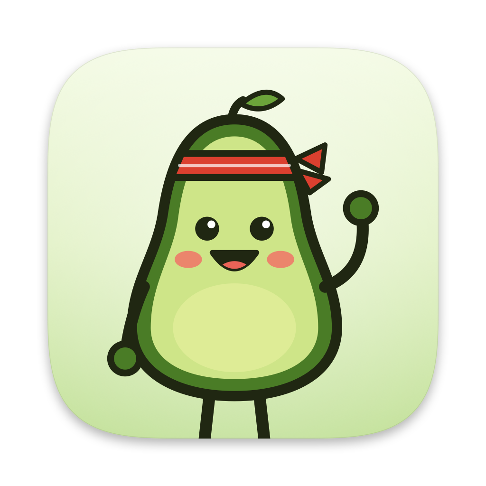
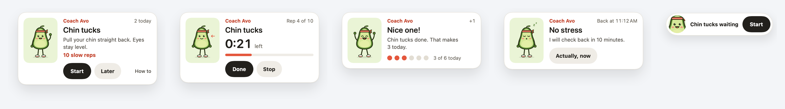
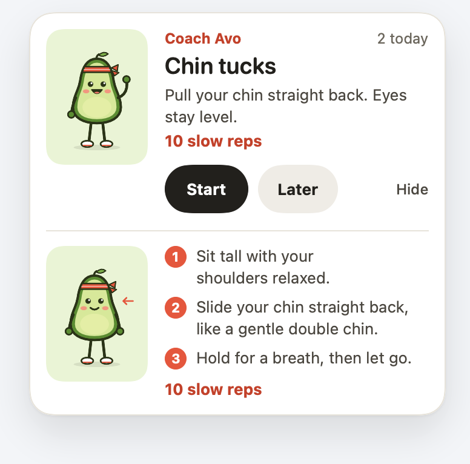
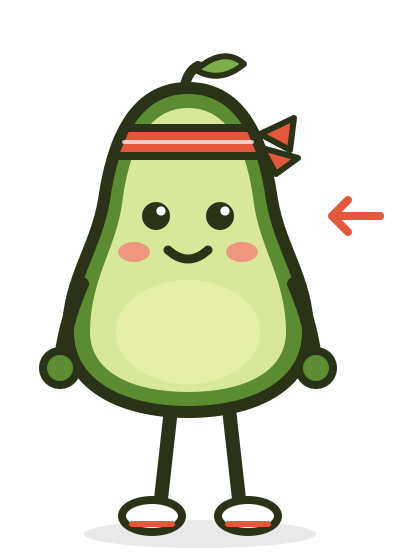
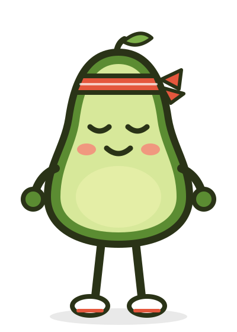

<div align="center">
  
  <h1>Avo</h1>
  <p><strong>A cheerful avocado coach in your Mac menu bar that nudges you to stretch while you work.</strong></p>

  <a href="https://github.com/thakobyan08/avo-the-coach/releases/latest"></a>
  
  
  <a href="LICENSE"></a>
  

  <br><br>
  
</div>

<br>

Every 25 minutes or so of real work, Avo slides in at the top of your screen with **one small move**: chin tucks, a neck stretch, a lap around the room. Start it, snooze it, or ignore it. Avo never steals focus from what you are typing, stays quiet during calls, and keeps everything on your Mac.

## Features

- **One nudge, one move, under 2 minutes.** Eight simple desk stretches, each with a short How to.
- **Never in your way.** The card doesn't take keyboard focus, so you can keep typing, and it tucks into a small pill if you leave it alone.
- **Knows when to stay quiet.** No nudges while your camera or mic is on, while a full-screen app is in front, or outside your work hours.
- **Counts real work only.** Time away from the keyboard counts as a break, and so does a sleeping Mac.
- **A daily goal and a streak.** Avo celebrates each move and keeps track of your day.
- **Private by design.** No account, no network, no analytics, and no special permissions needed.
- **Native and light.** Built with SwiftUI and lives in the menu bar, with no Dock icon.

## Install

Open **Terminal** and paste:

```sh
curl -fsSL https://raw.githubusercontent.com/thakobyan08/avo-the-coach/main/install.sh | bash
```

That's it. The script downloads the latest Avo, puts it in your Applications folder and opens it. Look for the avocado in your menu bar. Run it again any time to update.

**You need:** macOS 14 (Sonoma) or newer, on an Apple Silicon or Intel Mac. Nothing else.

## How it works



1. **Shows up.** After about 25 minutes of active work a card slides in at the top right.
2. **In progress.** Press **Start** and Avo counts the time and reps. Press **Done** when you finish.
3. **Done.** A quick celebration, and your count for today goes up.
4. **Snoozed.** **Later** brings the same move back in 10 minutes. The third Later in a row skips it.
5. **Left alone.** After a minute the card tucks into a pill at the screen edge. Hover it for **✕**.

Not sure how to do a move? Press **How to** to see Avo do it, with three short steps.

<br clear="right">

## The moves

| | Move | How | Default |
|:-:|------|-----|---------|
|  | Chin tucks | Pull your chin straight back. Eyes stay level. | 10 slow reps |
|  | Neck side stretch | Ear toward shoulder. Let the other shoulder sink. | 20 sec each side |
|  | Shoulder rolls | Big slow circles, rolling backward. | 10 reps |
|  | Upper back opener | Hands behind your head, lift your chest over the chair back. | 8 reps |
|  | Overhead reach | Fingers laced, push the ceiling away. | 3 holds of 10 sec |
|  | Eye break | Look at something about 20 feet away. | 20 sec |
|  | Walkabout | Stand up, refill your water, take a lap. | 2 min |
|  | Slow breaths | In for 4, out for 6. Shoulders stay low. | 5 breaths |

Turn moves on or off and change their doses in **Settings › Moves**.

## Using Avo

Click the avocado in the menu bar for:

- **Nudge me now**: try a move right away.
- **Pause 1 hour** or **Pause until tomorrow**, and **Resume**.
- Today's count, your goal and your streak.
- **Settings…**: interval, work hours and days, daily goal, moves and doses, every timing, sound, and **Launch Avo at login**.

## Privacy

Avo makes no network calls and has no analytics. To decide when to stay quiet it checks, on your Mac only, how long since your last keyboard or mouse input, whether your camera or microphone is in use, and whether the front app is full screen. It never reads what you type or what is on your screen. Settings live in your user defaults, and your daily counts in `~/Library/Application Support/Avo`.

## FAQ

<details>
<summary><strong>Why install from Terminal instead of a download?</strong></summary>
<br>
Avo isn't notarized through Apple's paid developer program yet, so a download from the browser would be blocked on first launch. The install script fetches the same app from this repo's <a href="https://github.com/thakobyan08/avo-the-coach/releases/latest">Releases</a> and opens it without that extra step. You can <a href="install.sh">read the script</a> before running it.
</details>

<details>
<summary><strong>Can I build it myself?</strong></summary>
<br>
Yes. Open <code>Avo.xcodeproj</code> in Xcode and press Run. See <a href="CONTRIBUTING.md">CONTRIBUTING.md</a>.
</details>

<details>
<summary><strong>Avo doesn't show up during my calls. Why?</strong></summary>
<br>
On purpose. While your camera or microphone is in use, or a full-screen app is in front, Avo waits and checks back a minute after you are done. The menu tells you why Avo is quiet.
</details>

<details>
<summary><strong>Avo never shows up at all.</strong></summary>
<br>
Check your work hours in <strong>Settings › Schedule</strong> (Monday to Friday, 9:00 to 19:00 by default) and that Avo isn't paused. <strong>Nudge me now</strong> always works.
</details>

## Uninstall

1. Click the avocado › **Quit Avo**.
2. Delete `/Applications/Avo.app`.
3. Optional, to remove your settings and history:
   ```sh
   defaults delete com.thakobyan08.avo
   rm -rf ~/Library/Application\ Support/Avo
   ```

## Contributing

Bug reports, ideas and pull requests are welcome. See [CONTRIBUTING.md](CONTRIBUTING.md) to build Avo and run the tests.

## License

[MIT](LICENSE)
